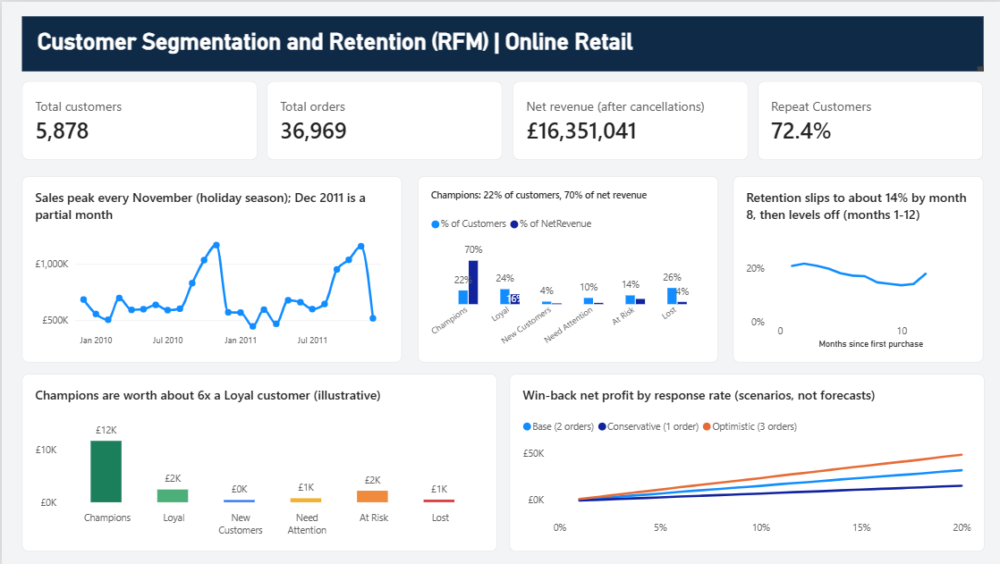

# Customer Segmentation and Retention Strategy (RFM)

An end-to-end customer analytics project on the UCI **Online Retail II** dataset (Dec 2009 to Dec 2011, GBP). It cleans the raw data with Python, analyses it with SQL, segments customers with RFM scoring, measures retention and customer lifetime value, models a win-back campaign, and presents everything in a one-page Power BI dashboard.

**Tools:** Python (pandas, NumPy), SQL (SQLite), Power BI, Excel



---

## 1. Business problem

An online retailer sells to the same customers repeatedly, but it does not know which customers drive its revenue, which are slipping away, or whether a win-back offer would pay for itself.

This project answers four questions:

1. Who are the most valuable customers, and how much revenue do they bring?
2. How many new customers come back, and how fast does retention fall?
3. What is a customer in each segment worth over their lifetime?
4. At what response rate does a win-back campaign for At Risk customers break even?

---

## 2. Key findings

| Metric | Result |
|---|---|
| Customers analysed | 5,878 |
| Orders | 36,969 |
| Gross sales | £17.37M |
| Net revenue (after cancellations) | £16.35M |
| Average order value | £469.98 |
| Repeat customers | 72.4% |

- **Revenue is concentrated.** Champions are about 22% of customers but 69.6% of net revenue.
- **Sales are seasonal.** Monthly sales peak every November (Nov 2010 and Nov 2011).
- **Retention falls fast, then levels off.** On average, about one in five new customers is active in a given month after their first purchase, and retention drops to roughly 14% by month 8.
- **Customer value differs sharply by segment.** Estimated lifetime value is about £12K for Champions, against about £2K for Loyal and At Risk customers.
- **A win-back campaign can pay for itself.** In the what-if model, net profit is positive at response rates above the break-even rate. At a 20% response rate it is roughly £16K (conservative), £32K (base) and £49K (optimistic). Exact values are in `campaign_sim.csv` and `campaign_breakeven.csv`.

---

## 3. Dataset

- **Source:** UCI Machine Learning Repository, *Online Retail II*.
- **Period:** 01 Dec 2009 to 09 Dec 2011. **Currency:** GBP.
- **Raw files:** two Excel sheets (2009-2010 and 2010-2011), placed under `dataset/raw_dataset/`.
- The raw data is not included in this repository because of its size. Download it from the UCI repository and place it in `dataset/raw_dataset/`.

---

## 4. Project structure

```
Customer Segmentation (RFM)/
├── README.md
├── python/
│   ├── clean_data.py            # clean raw Excel, create cleaned CSVs
│   ├── load_to_sqlite.py        # load clean_sales.csv into retail.db
│   ├── create_rfm_sql_table.py  # build the rfm_sql table in SQL
│   ├── rfm_segments.py          # RFM scores, segments, SQL cross-check
│   ├── cohort_clv.py            # cohort retention and lifetime value
│   ├── campaign_sim.py          # win-back campaign what-if model
│   └── powerbi_prep.py          # pre-aggregated tables for Power BI
├── sql/
│   └── analysis.sql             # 9 analysis queries (Q1-Q9)
├── dataset/
│   ├── raw_dataset/             # (not in repo) original Excel files
│   ├── dataset_processed/       # cleaned and analysis CSVs
│   └── powerbi_ready/           # CSVs loaded into Power BI
├── powerbi/
│   └── rfm_dashboard_v2.pbix
├── excel/                       # dashboard layout spreadsheet
└── screenshots/
```

---

## 5. How to run it

1. Install Python 3.10+ and the packages: `pip install pandas numpy openpyxl`
2. Put the two Online Retail II Excel files in `dataset/raw_dataset/`.
3. Run the scripts from the project folder, in this order:

```
python python/clean_data.py
python python/load_to_sqlite.py
python python/create_rfm_sql_table.py
python python/rfm_segments.py
python python/cohort_clv.py
python python/campaign_sim.py
python python/powerbi_prep.py
```

4. Open `powerbi/rfm_dashboard_v2.pbix` in Power BI Desktop. If it asks for the data, point it to `dataset/powerbi_ready/`.

> The SQLite database is included as `dataset/retail.zip`. Unzip it into `dataset/`, or recreate it with `python python/load_to_sqlite.py`.

---

## 6. Method

### 6.1 Data cleaning (`clean_data.py`)
- Read every `.xlsx` file in `dataset/raw_dataset/` and combine them.
- Rename columns: `Invoice` to `InvoiceNo`, `Price` to `UnitPrice`, `Customer ID` to `CustomerID`.
- Remove exact duplicate rows.
- Separate **cancellations** (invoice numbers that start with "C") into `cancellations.csv`.
- Drop rows with no `CustomerID` (they cannot be linked to a customer).
- Keep rows with `Quantity > 0` and `UnitPrice > 0`.
- Add `Revenue`, `YearMonth` and `Weekday`.
- Every step and its row count is written to `cleaning_log.csv`.

| Step | Rows remaining | Rows removed |
|---|---|---|
| Raw rows (both files stacked) | 1,067,371 | - |
| Remove duplicate rows | 1,033,036 | 34,335 |
| Separate cancellations | 1,013,932 | 19,104 |
| Drop missing CustomerID | 779,495 | 234,437 |
| Remove Quantity <= 0 or UnitPrice <= 0 | 779,425 | 70 |

**Final clean dataset: 779,425 rows** (about 73% of the raw rows). Nearly a quarter of the raw rows had no customer ID, which is the largest single loss. See the limitations section.

### 6.2 SQL analysis (`analysis.sql`)
Nine queries on SQLite: overall summary, monthly sales, top customers, sales by country, repeat-purchase rate, top products, sales by weekday, revenue quintiles and RFM scores (using `NTILE` window functions). The RFM table built in SQL is cross-checked against the pandas version, and the two match.

### 6.3 RFM segmentation (`rfm_segments.py`)
- **Recency:** days since the last purchase, using a snapshot date of 2011-12-10.
- **Frequency:** number of distinct invoices.
- **Monetary:** *net* spend, which is gross sales minus the value of cancelled or returned orders.
- Each measure is scored 1 to 5 using quintiles.
- Segment rules are applied in this order, and the first match wins:

| Segment | Rule |
|---|---|
| Champions | R ≥ 4, F ≥ 4, M ≥ 4 |
| Loyal | R ≥ 3, F ≥ 3 |
| New Customers | R ≥ 4 and one order only |
| At Risk | R ≤ 2, F ≥ 3 |
| Lost | R ≤ 2, F ≤ 2 |
| Need Attention | everyone else |

### 6.4 Retention and lifetime value (`cohort_clv.py`)
- **Cohort = month of first purchase.** Retention is the share of each cohort that buys again in later months.
- The December 2009 cohort is the existing customer base, not truly new, and December 2011 is excluded as a partial month.
- **Simple CLV** = average order value × orders per year × expected lifespan, where lifespan = 1 / (1 − annual retention). Annual retention is 62.9%.

### 6.5 Win-back campaign model (`campaign_sim.py`)
A what-if model for the At Risk segment, with these assumptions:

| Assumption | Value |
|---|---|
| Discount | 10% |
| Gross margin | 40% |
| Cost per contact | £1.00 |
| Fixed campaign cost | £500 |
| Orders after win-back | 1, 2 or 3 (three scenarios) |
| Response rate | 1% to 20% |

Profit per order = average order value × (margin − discount). The model reports net profit by response rate and the break-even response rate.

### 6.6 Dashboard (Power BI)
One page: four KPI cards, monthly sales, share of customers vs share of revenue by segment, average retention of new customers, lifetime value by segment and win-back net profit by response rate. Data is pre-aggregated in Python (`powerbi_prep.py`), so the report uses no relationships and no complex DAX. Two small DAX measures format the card numbers.

---

## 7. Limitations and assumptions

- **Cancellations.** Cancelled orders are removed from net revenue, but the original sale is not always matched to its return. 39 customers end with net spend of zero or less.
- **Missing customers.** Rows with no `CustomerID` are dropped, so the analysis covers identified customers only.
- **Partial month.** December 2011 contains only the first nine days, so it looks like a sales drop. It is flagged on the chart and excluded from retention.
- **CLV is illustrative.** The formula assumes constant order value and a constant retention rate. It overstates the value of At Risk and Lost customers, because their recent behaviour is worse than the average.
- **Campaign model is a scenario tool, not a forecast.** Margin, discount, contact cost and response rate are assumptions. Real response rates should come from an A/B test.
- **Seasonality.** Retention and sales are influenced by the Christmas peak, which is concentrated in November.
- **Data period.** The data ends in 2011. The method applies to current data, but the specific numbers describe that period.

---

## 8. What I would do next

- Replace the simple CLV with a probabilistic model (BG/NBD and Gamma-Gamma).
- Run an A/B test design for the win-back offer.
- Add product-level analysis (which products Champions buy).
- Add a second dashboard page with a cohort heatmap, a top-customer table and revenue by country.

---

## 9. About

Built by **Pabolu Venkata Ram Tej** as a portfolio project.

**Contact:** [LinkedIn](https://www.linkedin.com/in/pabolu-venkata-ram-tej-664bbb2a6/) | [paboluramtej50@gmail.com](mailto:paboluramtej50@gmail.com)
